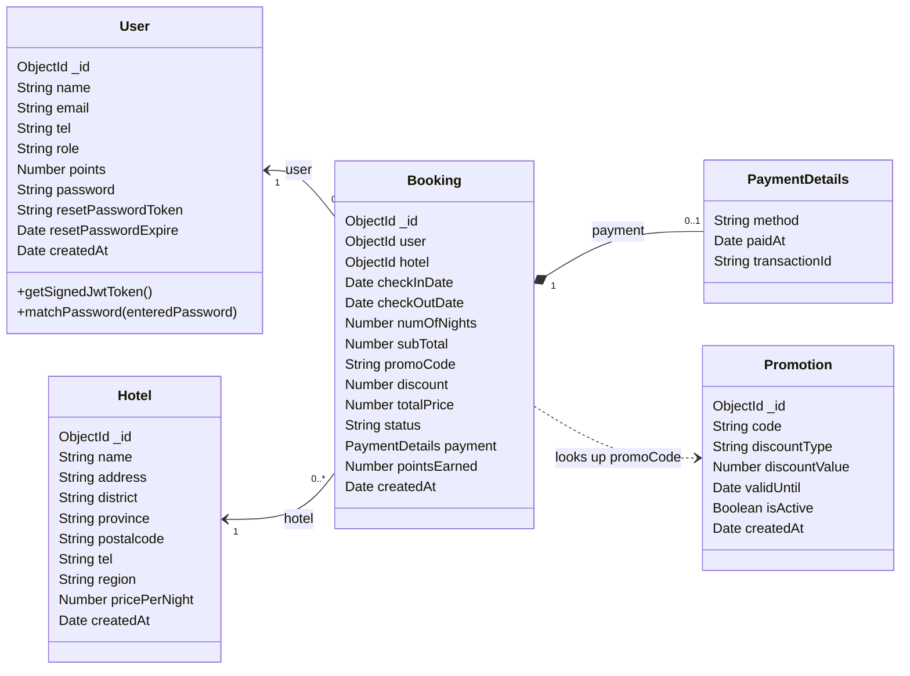

# Class Diagram: Hotel Booking System

This diagram follows the Mongoose models in `models/`. It shows stored fields and model methods; `_id` is created by Mongoose.

## ความสัมพันธ์และข้อกำหนด

- Booking แต่ละรายการเก็บ ObjectId ของ `user` และ `hotel` โดย User หรือ Hotel หนึ่งรายการมี Booking ได้หลายรายการ
- ข้อมูล `payment` ฝังอยู่ใน Booking ไม่ได้เป็น Collection แยกใน MongoDB วิธีชำระเงินที่รองรับคือ `credit_card`, `debit_card` และ `qr_code`
- Booking เก็บ `promoCode` เป็นข้อความ เมื่อสร้าง Booking ระบบค้นหา Promotion จากฟิลด์ `code` โดยไม่ได้เก็บ ObjectId ของ Promotion ไว้ใน Booking
- สถานะของ Booking คือ `pending`, `paid` หรือ `cancelled`; ประเภทส่วนลดของ Promotion คือ `percentage` หรือ `fixed`; บทบาทของ User คือ `user` หรือ `admin`
- Hotel มี virtual field ชื่อ `bookings` สำหรับดู Booking ที่เกี่ยวข้อง และเมื่อลบ Hotel ระบบจะลบ Booking ของโรงแรมนั้นผ่าน model hook
