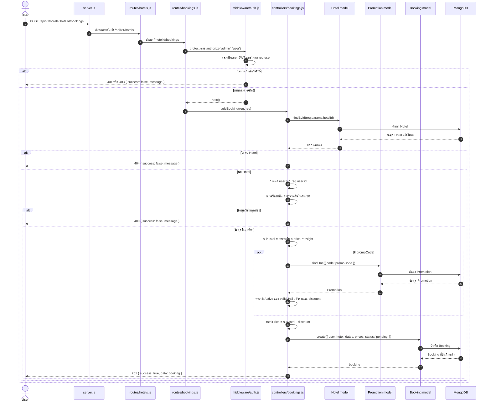

# Sequence Diagram: Book Hotel (POST)

การสร้าง Booking ผ่าน `POST /api/v1/hotels/:hotelId/bookings` โดยส่ง Bearer token, `checkInDate`, `checkOutDate` และ `promoCode` หากต้องการใช้ส่วนลด

## เงื่อนไขที่ใช้จริง

- ต้องมี `checkInDate` และ `checkOutDate` ที่แปลงเป็นวันที่ได้ โดยวันออกต้องหลังวันเข้า และจองได้ไม่เกิน 30 คืน หากไม่ผ่านจะได้ HTTP 400
- หากส่ง `promoCode` ระบบตรวจว่าโค้ดมีอยู่ เปิดใช้งาน ยังไม่หมดอายุ และจำนวนส่วนลดถูกต้อง หากไม่ผ่านจะได้ HTTP 400 และไม่สร้าง Booking
- หากไม่ส่ง `promoCode` ค่า `discount` เป็น 0; หากส่งโค้ดที่ถูกต้อง ระบบคำนวณส่วนลดแบบเปอร์เซ็นต์หรือจำนวนเงิน และไม่ให้ส่วนลดเกิน `subTotal`
- Booking ใหม่มี `status` เป็น `pending` และผูกกับ User ที่อยู่ใน JWT ไม่ใช้ User ID ที่ผู้เรียกส่งมา
- Endpoint `POST /api/v1/bookings` เรียก `addBooking` เดียวกัน โดยรับ Hotel ID จากฟิลด์ `hotel` ใน body แทนพารามิเตอร์ใน URL
