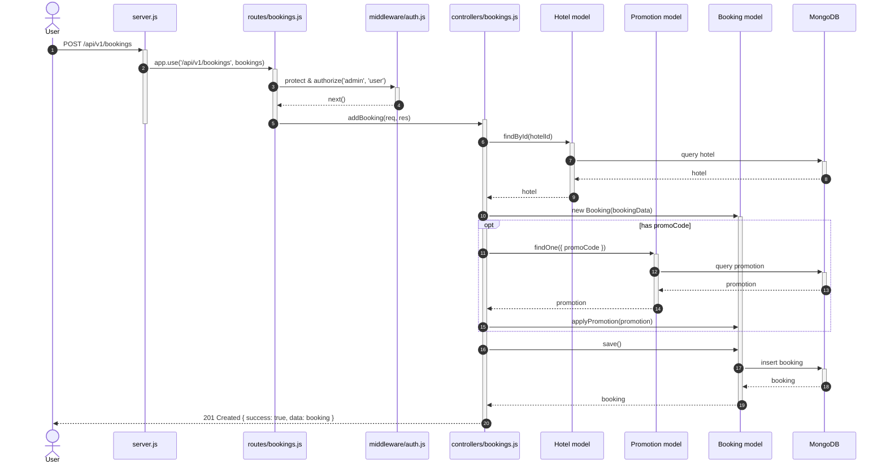

# Sequence Diagram: Book Hotel (POST)

Happy flow การสร้าง Booking ผ่าน `POST /api/v1/bookings` โดยส่ง Bearer token, `hotel`, `checkInDate`, `checkOutDate` และ `promoCode` หากต้องการใช้ส่วนลด

## เงื่อนไขที่ใช้จริง

- ต้องมี `checkInDate` และ `checkOutDate` ที่แปลงเป็นวันที่ได้ โดยวันออกต้องหลังวันเข้า และจองได้ไม่เกิน 30 คืน หากไม่ผ่านจะได้ HTTP 400
- หากส่ง `promoCode` ระบบค้นหาโปรโมชันแล้วเรียก `booking.applyPromotion(promotion)` เพื่อตรวจ `isActive`, `validUntil` และคำนวณส่วนลด (`percentage` หรือ `fixed` โดยไม่เกิน `subTotal`) หากไม่ผ่านจะได้ HTTP 400
- หากไม่ส่ง `promoCode` ค่า `discount` เป็น 0; Booking ใหม่มี `status` เป็น `pending` และผูกกับ User ที่อยู่ใน JWT
- รองรับทั้ง `POST /api/v1/bookings` และ `POST /api/v1/hotels/:hotelId/bookings` โดยเรียก `addBooking` เดียวกัน
