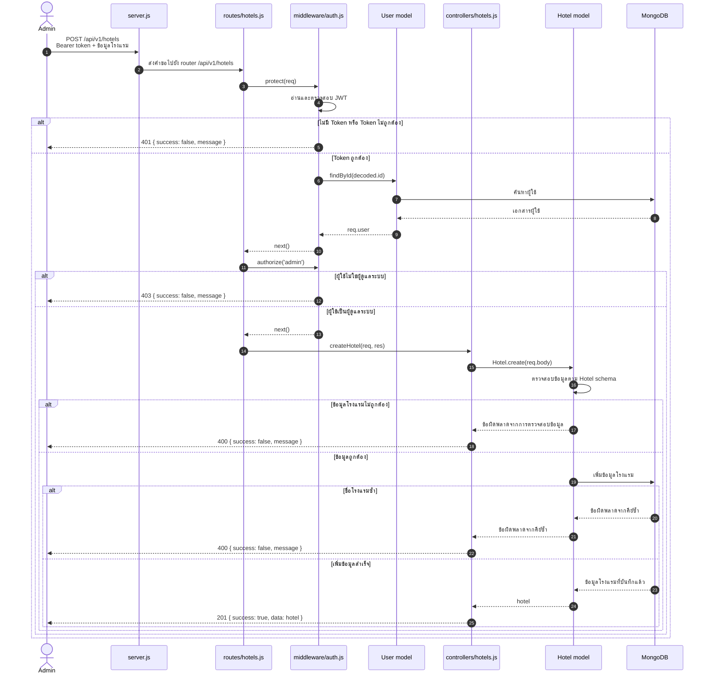

# Sequence Diagram: Manage Hotel (POST)

Endpoint: `POST /api/v1/hotels` — ผู้ดูแลระบบสร้างข้อมูลโรงแรม

ข้อมูลโรงแรมเป็นไปตาม `models/Hotel.js` ได้แก่ `name`, `address`, `district`, `province`, `postalcode` และ `pricePerNight`; ฟิลด์ที่ไม่บังคับ ได้แก่ `tel` และ `region`
